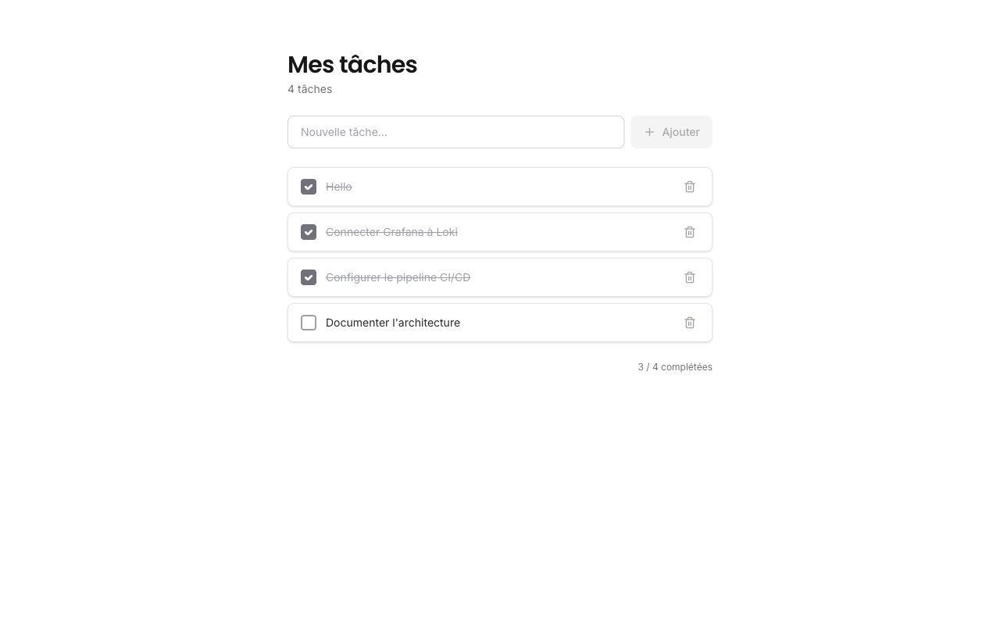

# aws-centralized-logging

A Docker Compose stack that collects the logs of every container, stores them in Loki and shows them in Grafana. A small Next.js todo app runs as two replicas behind Traefik and writes structured JSON logs, so there is real traffic to look at. GitLab CI builds the app image, pushes it to Amazon ECR and redeploys it on an EC2 instance.


## What it does

- Promtail reads the logs of every container that has the label `logging=promtail` and sends them to Loki.
- Promtail adds a `service`, `container` and `stream` label to each line. It reads the `level` field from JSON logs, and uses a regex to find the level in plain text logs (Postgres, Traefik).
- Loki keeps logs for 30 days (`retention_period: 30d` in `config/loki/loki-config.yml`).
- Grafana starts with Loki already set as the default data source and a provisioned dashboard: log volume per service, errors over time, split by level, and a live log stream.
- Traefik routes HTTPS traffic to the todo app and Grafana, with Let's Encrypt certificates (TLS challenge) and an HTTP to HTTPS redirect.
- Traefik and Promtail do not mount the Docker socket. They talk to `tecnativa/docker-socket-proxy`, which only exposes the containers, networks, events, info and ping endpoints.
- A backup container runs a cron job every 6 hours. It packs the Loki data into a `.tar.gz`, uploads it to S3 and deletes backups older than 7 days.
- Watchtower checks every 300 seconds for new images of containers that have the `com.centurylinklabs.watchtower.enable=true` label (the todo app).

## Architecture



Log flow:

```
Docker containers -> Promtail -> Loki -> Grafana
```

The stack uses three Docker networks. `web` holds Traefik and the services it exposes. `internal` holds Postgres, Loki, Promtail and the backup job. `socket-proxy` connects the socket proxy to Traefik and Promtail.

## Services and versions

Versions come from `docker-compose.yml`, `services/todo-app/package.json` and the Dockerfiles.

| Service | Image or tool | Role |
| --- | --- | --- |
| socket-proxy | `tecnativa/docker-socket-proxy:0.3.0` | Read-only access to the Docker API |
| traefik | `traefik:v3.7.0` | Reverse proxy, TLS, load balancing |
| postgres | `postgres:16-alpine` | Database for the todo app |
| todo-app | Next.js 16.1.6, React 19.2.3, on `oven/bun:1.3.13` | Demo app, 2 replicas |
| promtail | `grafana/promtail:2.9.0` | Log collection |
| loki | `grafana/loki:2.9.0` | Log storage |
| grafana | `grafana/grafana:10.2.0` | Dashboards and LogQL queries |
| backup | `alpine:3.19` with AWS CLI and cron | Loki backup to S3 |
| watchtower | `containrrr/watchtower:1.7.1` | Automatic image updates |

Secrets come from [Doppler](https://doppler.com/) (project `logs`, configs `dev` and `prd`) or from a local `.env` file.

## How to run it locally

You need Docker with Docker Compose. The `make` targets also need the Doppler CLI, logged in.

```bash
git clone https://github.com/vianneymougang/aws-centralized-logging.git
cd aws-centralized-logging
```

Without Doppler, copy the example file, fill in the values, and start the stack:

```bash
cp .env.example .env
docker compose -f docker-compose.yml -f docker-compose.override.yml up -d
```

With Doppler, use the Makefile. It runs `doppler run --project logs --config $(ENV)` before each Compose command. `ENV` is `dev` by default, which adds `docker-compose.override.yml`.

```bash
make up        # start all services
make health    # show name, status and health of each container
make logs      # follow the logs of all services
make down      # stop all services
```

Other targets: `make restart` (`--force-recreate`), `make build` (`--no-cache`), `make pull`, `make ps`, and `make deploy`. Pass `ENV=prd` to use the production config, for example `make up ENV=prd`.

Without `DOMAIN`, the stack uses `localhost`. Browsers resolve `*.localhost` to your machine with no setup. Let's Encrypt does not issue certificates for `localhost`, so Traefik serves a self-signed one that you need to accept.

| Service | URL |
| --- | --- |
| Todo app | https://todo.localhost |
| Grafana | https://logs.localhost or http://localhost:3001 |
| Traefik dashboard | http://localhost:8080/dashboard/ |

Log in to Grafana with `GRAFANA_USER` and `GRAFANA_PASSWORD`. Check the todo app from the command line:

```bash
curl -k --resolve todo.localhost:443:127.0.0.1 https://todo.localhost/api/health
```

The health route returns the container hostname. Call it a few times and you will see Traefik switch between the two replicas.



To see errors in Grafana, stop the database and use the app for a moment:

```bash
docker compose stop postgres
docker compose start postgres
```

Some LogQL queries to try in Grafana Explore:

```logql
{service="todo-app"}
{service="todo-app"} | json | level="ERROR"
{service="traefik"}
```

## AWS deployment

The pipeline in `.gitlab-ci.yml` runs on pushes to `main`, on a GitLab runner tagged `ec2` that lives on the EC2 instance. It has three stages:

- `build` builds the `todo-app` image, tagged with the short commit SHA and `latest`, and saves it as a job artifact. It runs only when `services/todo-app/` or `.gitlab-ci.yml` changes.
- `push` logs in to Amazon ECR in `eu-central-1`, creates the `todo-app` repository if it does not exist, and pushes both tags.
- `deploy` runs `git pull origin main` in the project folder on the instance, then `make deploy ENV=prd`. It also runs when `docker-compose.yml` or `config/` changes.

The only CI variable is `DOPPLER_TOKEN`. The jobs download every other secret (AWS keys, account ID, database and Grafana passwords) from the Doppler `prd` config at run time.

In production, set `DOMAIN` in the Doppler `prd` config or in `.env`, and create two DNS A records, `todo.<DOMAIN>` and `logs.<DOMAIN>`, that point to the instance's Elastic IP. The Traefik dashboard has no public route because it has no authentication. It listens on port 8080, which the security group keeps closed, so you reach it through an SSH tunnel:

```bash
ssh -i your-key.pem -L 8080:localhost:8080 ubuntu@<elastic-ip>
```

The deployment guide describes the setup step by step: a `t3.small` instance on Ubuntu 24.04 with ports 22, 80 and 443 open, an Elastic IP, the ECR repository, two DNS A records, the runner registration, and the first manual `docker compose up -d`.

## Documentation

The detailed docs are in French:

- [docs/DEPLOIEMENT.md](./docs/DEPLOIEMENT.md): the AWS deployment guide.
- [services/todo-app/README.md](./services/todo-app/README.md): the todo app API and log format.

## Project context

I built this for a cloud course at Saint Jean Ingénieur in 2026. Solo project.

## License

MIT. See [LICENSE](./LICENSE).
