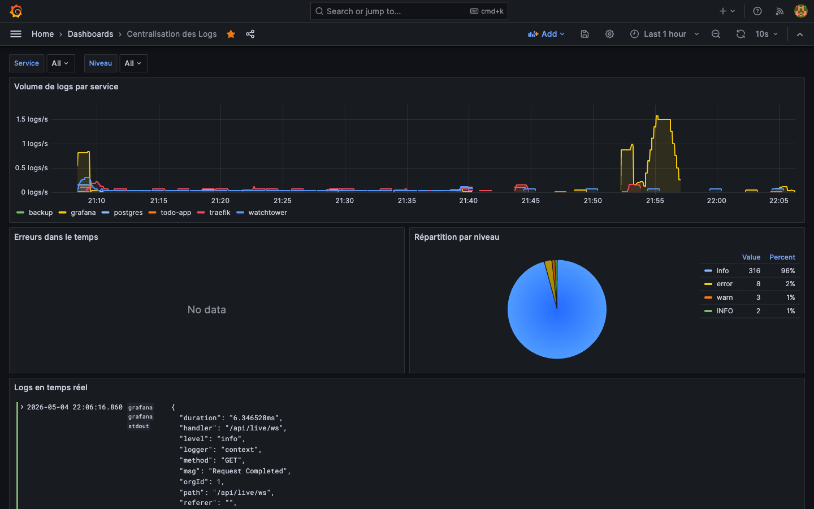

# Centralisation des logs applicatifs

Projet réalisé dans le cadre du cours **Cloud, Virtualisation & Datacenter** — Institut Saint Jean.

Stack Docker Compose qui collecte les logs de tous les conteneurs (application, base de données, reverse proxy, outils), les stocke dans Loki et les affiche dans Grafana. Une application Next.js de démonstration tourne en deux répliques derrière Traefik et écrit des logs JSON structurés. GitLab CI construit l'image, la pousse sur Amazon ECR et la redéploie sur une instance EC2.



---

## Table des matières

- [Architecture](#architecture)
- [Stack technique](#stack-technique)
- [Prérequis](#prérequis)
- [Démarrage rapide](#démarrage-rapide)
- [Gestion des secrets — Doppler](#gestion-des-secrets--doppler)
- [Commandes Makefile](#commandes-makefile)
- [Interfaces et accès](#interfaces-et-accès)
- [Load balancing](#load-balancing)
- [Explorer les logs](#explorer-les-logs)
- [Pipeline CI/CD](#pipeline-cicd)
- [Structure du projet](#structure-du-projet)
- [Réutiliser le projet](#réutiliser-le-projet)
- [Licence](#licence)

---

## Architecture


**Flux des logs :**

```
Conteneurs Docker → Promtail → Loki → Grafana
```

Promtail collecte les logs de tous les conteneurs labellisés `logging=promtail`, les enrichit avec des labels (nom du service, niveau de log), puis les envoie à Loki. Grafana interroge Loki via LogQL pour les visualiser en temps réel.

L'accès au socket Docker est délégué au **socket-proxy** (tecnativa), qui expose uniquement les endpoints nécessaires à Traefik et Promtail, sans jamais monter le socket directement dans ces conteneurs.

---

## Stack technique

| Rôle                         | Outil                                                                    | Version  |
| ---------------------------- | ------------------------------------------------------------------------ | -------- |
| Reverse proxy + TLS          | [Traefik](https://traefik.io/)                                           | v3.7.0   |
| Application de démonstration | [Next.js](https://nextjs.org/) sur [Bun](https://bun.sh/), 2 répliques  | 16       |
| Base de données              | [PostgreSQL](https://www.postgresql.org/)                                | 16       |
| Collecte des logs            | [Promtail](https://grafana.com/docs/loki/latest/send-data/promtail/)    | 2.9      |
| Stockage des logs            | [Loki](https://grafana.com/oss/loki/)                                    | 2.9      |
| Visualisation                | [Grafana](https://grafana.com/)                                          | 10.2     |
| Mises à jour automatiques    | [Watchtower](https://containrrr.dev/watchtower/)                         | 1.7.1    |
| Backup des données           | Script custom AWS CLI                                                    | —        |
| Proxy Docker socket          | [tecnativa/docker-socket-proxy](https://github.com/Tecnativa/docker-socket-proxy) | 0.3.0 |
| Gestion des secrets          | [Doppler](https://doppler.com/)                                          | CLI      |
| CI/CD                        | GitLab CI                                                                | —        |
| Container registry           | Amazon ECR                                                               | —        |
| Déploiement                  | EC2 (Ubuntu 24.04) + GitLab Runner                                       | —        |

---

## Prérequis

- Docker >= 24 et Docker Compose >= 2.20
- [Doppler CLI](https://docs.doppler.com/docs/install-cli) installé et authentifié (`doppler login`)
- Un compte AWS (pour ECR et le backup S3)
- Une instance EC2 avec Docker et le GitLab Runner installés (pour le CI/CD)

---

## Démarrage rapide

### 1. Cloner le dépôt

```bash
git clone https://github.com/Storzen/projet-logs.git
cd projet-logs
```

### 2. Configurer les secrets

Les secrets sont gérés via **Doppler** (voir la section dédiée). Pour un démarrage en développement sans Doppler, copier l'exemple et renseigner les valeurs :

```bash
cp .env.example .env
# Éditer .env avec vos valeurs
```

> `.env` est ignoré par Git. Seul `.env.example` est versionné.

### 3. Lancer la stack

```bash
# Avec Doppler (recommandé)
make up

# Sans Doppler (variables dans .env)
docker compose -f docker-compose.yml -f docker-compose.override.yml up -d
```

### 4. Vérifier l'état des services

```bash
make health
```

Tous les services doivent afficher un statut `healthy`.

---

## Gestion des secrets — Doppler

Ce projet utilise [Doppler](https://doppler.com/) pour centraliser et injecter les secrets, aussi bien en développement qu'en production. Il n'y a **aucun secret stocké en clair** dans le dépôt.

### Projet Doppler

- **Projet** : `logs`
- **Config dev** : `dev`
- **Config prod** : `prd`

### Variables gérées par Doppler

| Clé                     | Usage                                 |
| ----------------------- | ------------------------------------- |
| `POSTGRES_DB`           | Nom de la base de données             |
| `POSTGRES_USER`         | Utilisateur PostgreSQL                |
| `POSTGRES_PASSWORD`     | Mot de passe PostgreSQL               |
| `GRAFANA_USER`          | Identifiant admin Grafana             |
| `GRAFANA_PASSWORD`      | Mot de passe admin Grafana            |
| `AWS_ACCESS_KEY_ID`     | Auth ECR + backup S3                  |
| `AWS_SECRET_ACCESS_KEY` | Auth ECR + backup S3                  |
| `AWS_ACCOUNT_ID`        | Construction de l'URL ECR             |
| `AWS_DEFAULT_REGION`    | Région AWS cible                      |
| `S3_BUCKET_NAME`        | Bucket S3 pour les backups Loki       |
| `ACME_EMAIL`            | Email Let's Encrypt (certificats TLS) |
| `DOMAIN`                | Domaine racine (`todo.` et `logs.`)   |

### Se connecter à Doppler

```bash
doppler login
doppler setup --project logs --config dev
```

---

## Commandes Makefile

Le `Makefile` encapsule les commandes Docker Compose avec injection automatique des secrets Doppler.

| Commande        | Description                                              |
| --------------- | -------------------------------------------------------- |
| `make up`       | Démarrer tous les services (mode dev avec override)      |
| `make down`     | Arrêter tous les services                                |
| `make restart`  | Redémarrer tous les services (`--force-recreate`)        |
| `make build`    | Rebuilder les images localement (`--no-cache`)           |
| `make pull`     | Télécharger les dernières images depuis les registries   |
| `make deploy`   | Mettre à jour uniquement `todo-app` depuis ECR           |
| `make logs`     | Suivre les logs de tous les services en temps réel       |
| `make ps`       | Lister l'état des conteneurs                             |
| `make health`   | Afficher le statut de santé formaté de chaque service    |

Pour forcer l'environnement de production :

```bash
make up ENV=prd
```

---

## Interfaces et accès

La variable `DOMAIN` fixe le domaine racine. Traefik route `todo.<DOMAIN>` vers la todo app et `logs.<DOMAIN>` vers Grafana, avec des certificats Let's Encrypt.

### En local

Sans `DOMAIN`, la stack utilise `localhost`. Les navigateurs résolvent `*.localhost` vers la machine locale sans configuration :

| Service           | URL                               |
| ----------------- | --------------------------------- |
| Todo App          | https://todo.localhost            |
| Grafana           | https://logs.localhost, ou http://localhost:3001 |
| Dashboard Traefik | http://localhost:8080/dashboard/  |

Let's Encrypt ne délivre pas de certificat pour `localhost` : Traefik sert un certificat auto-signé qu'il faut accepter dans le navigateur. En ligne de commande :

```bash
curl -k --resolve todo.localhost:443:127.0.0.1 https://todo.localhost/api/health
```


### En production (AWS EC2)

Renseigner `DOMAIN` dans Doppler (config `prd`) ou dans le `.env`, puis créer deux enregistrements DNS A, `todo.<DOMAIN>` et `logs.<DOMAIN>`, vers l'Elastic IP de l'instance.

Le dashboard Traefik n'a pas de route publique : il n'a pas d'authentification. Il écoute sur le port 8080 de l'instance, que le security group laisse fermé. Pour le consulter, ouvrir un tunnel SSH :

```bash
ssh -i ta-cle.pem -L 8080:localhost:8080 ubuntu@<Elastic IP>
# puis http://localhost:8080/dashboard/
```

### Datasource et dashboard Grafana

Grafana démarre déjà configuré. Le fichier `config/grafana/provisioning/datasources/loki.yml` déclare Loki (`http://loki:3100`) comme datasource par défaut, et `config/grafana/dashboards/logs-overview.json` fournit le dashboard « Centralisation des Logs » : volume de logs par service, erreurs dans le temps, répartition par niveau et flux en temps réel, filtrables par service et par niveau.

Identifiants : `GRAFANA_USER` / `GRAFANA_PASSWORD`, issus de Doppler ou du `.env`.

---

## Load balancing

La todo app tourne avec **2 répliques**. Traefik les découvre automatiquement via les labels Docker et distribue le trafic entre elles en round-robin.

### Vérifier que les deux instances sont actives

Dans le dashboard Traefik (`http://localhost:8080/dashboard/`, par tunnel SSH en production), la section **HTTP → Services → todo** doit afficher 2 serveurs avec un statut `UP`.

En ligne de commande sur l'EC2 :

```bash
docker compose ps todo-app
```

Doit lister deux conteneurs (`projet-logs-todo-app-1` et `projet-logs-todo-app-2`), tous deux `healthy`.

### Vérifier le load balancing en action

```bash
for i in $(seq 1 6); do
  curl -sk https://todo.localhost/api/health | grep -o '"hostname":"[^"]*"'
done
```

Chaque requête doit alterner entre les deux hostnames de conteneur, confirmant que Traefik distribue bien le trafic.

---

## Explorer les logs

Dans Grafana → **Explore**, quelques requêtes LogQL utiles :

```logql
# Tous les logs de la todo app
{service="todo-app"}

# Uniquement les erreurs
{service="todo-app"} | json | level="ERROR"

# Tous les services filtrés par niveau
{level="WARN"}

# Logs PostgreSQL
{service="postgres"}

# Logs Traefik
{service="traefik"}

# Logs d'une réplique spécifique
{service="todo-app", container="projet-logs-todo-app-1"}
```

### Générer des logs de test

La todo app émet des logs JSON structurés à chaque action. Pour provoquer des erreurs visibles dans Grafana :

```bash
docker compose stop postgres
# Effectuer des actions dans la todo app — des ERROR apparaissent dans Grafana
docker compose start postgres
```

---

## Pipeline CI/CD

Le pipeline GitLab CI se déclenche automatiquement à chaque push sur `main` et comporte 3 stages :

```
build → push (ECR) → deploy (EC2)
```

- **build** : construit l'image Docker de `todo-app` sur le runner EC2, la sauvegarde en artifact
- **push** : pousse l'image vers Amazon ECR (création automatique du repository si absent)
- **deploy** : se connecte à l'EC2, pull le dépôt, et redémarre `todo-app` via `make deploy ENV=prd`

### Variable GitLab requise

Une seule variable suffit dans **GitLab → Settings → CI/CD → Variables** :

| Variable        | Description                                          |
| --------------- | ---------------------------------------------------- |
| `DOPPLER_TOKEN` | Service token Doppler (projet `logs`, config `prd`)  |

Tous les autres secrets (AWS, PostgreSQL, Grafana) sont injectés automatiquement par Doppler lors de l'exécution du pipeline.

Générer le service token dans Doppler : **logs → prd → Access → Generate Service Token**.

### Installer le GitLab Runner sur EC2

```bash
# Installation
curl -L "https://packages.gitlab.com/install/repositories/runner/gitlab-runner/script.deb.sh" | sudo bash
sudo apt install gitlab-runner

# Enregistrement (token disponible dans GitLab → Settings → CI/CD → Runners)
sudo gitlab-runner register \
  --url https://gitlab.com \
  --token <TOKEN> \
  --executor docker \
  --docker-image docker:24 \
  --description "ec2-runner"

# Ajouter le tag "ec2" dans GitLab après enregistrement
# Settings → CI/CD → Runners → ton runner → Edit → Tags

# Autoriser le runner à utiliser Docker
sudo usermod -aG docker gitlab-runner
```

---

## Structure du projet

```
projet-logs/
│
├── .gitlab-ci.yml              ← pipeline CI/CD (build → ECR → deploy)
├── docker-compose.yml          ← stack de production
├── docker-compose.override.yml ← surcharges pour le développement local
├── Makefile                    ← commandes avec injection Doppler
├── .env.example                ← template des variables d'environnement
│
├── config/
│   ├── grafana/
│   │   ├── dashboards/         ← dashboards pré-provisionnés
│   │   └── provisioning/       ← datasources et dashboards auto-chargés
│   ├── loki/
│   │   └── loki-config.yml     ← configuration du stockage Loki
│   └── promtail/
│       └── promtail-config.yml ← règles de collecte et parsing des logs
│
├── LICENSE                     ← licence MIT
│
├── docs/
│   └── DEPLOIEMENT.md          ← guide de déploiement AWS pas à pas
│
├── screenshots/                ← captures utilisées dans ce README
│
└── services/
    ├── backup/
    │   ├── Dockerfile          ← image Alpine avec AWS CLI + cron
    │   ├── backup.sh           ← script de backup Loki → S3
    │   └── crontab             ← planification des backups
    │
    ├── postgres/
    │   └── init.sql            ← schéma initial de la base de données
    │
    └── todo-app/               ← application Next.js de démonstration
        ├── Dockerfile          ← build multi-stage (non-root, Bun)
        ├── app/
        │   ├── layout.tsx
        │   ├── page.tsx
        │   └── api/
        │       ├── health/route.ts
        │       └── todos/
        │           ├── route.ts        ← GET, POST
        │           └── [id]/route.ts   ← PATCH, DELETE
        ├── components/
        │   └── todo-list.tsx   ← UI avec optimistic updates
        └── lib/
            ├── db.ts           ← pool de connexions PostgreSQL
            ├── logger.ts       ← logs JSON structurés
            └── utils.ts        ← utilitaire Tailwind
```

---

## Réutiliser le projet

Le dépôt est écrit pour un déploiement précis. Pour le faire tourner chez vous, changez :

- **Le domaine.** Renseignez `DOMAIN` et créez les enregistrements DNS A `todo.<DOMAIN>` et `logs.<DOMAIN>`.
- **Le projet Doppler.** Le `Makefile` attend un projet `logs` avec les configs `dev` et `prd`. Changez `DOPPLER_PROJECT`, ou lancez Docker Compose directement avec un `.env`.
- **Le runner GitLab.** Les jobs ciblent un runner tagué `ec2`.

Le guide [docs/DEPLOIEMENT.md](./docs/DEPLOIEMENT.md) détaille la mise en place AWS (EC2, Elastic IP, ECR), le DNS et le runner.

---

## Licence

Distribué sous licence MIT. Voir [LICENSE](./LICENSE).
